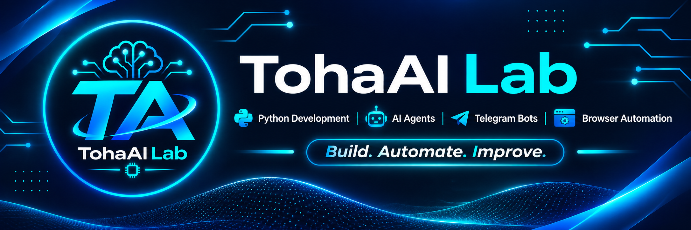

# ⚡ TohaAI Lab

### Python Development · AI Agents · Intelligent Automation

Welcome to TohaAI Lab — an independent software development and automation lab focused on practical, real-world solutions.

---

## 🚀 What I Do

- Telegram bots and custom automation tools
- AI agents and LLM integration
- Browser automation with Playwright
- Web scraping and structured data extraction
- REST API integration
- Linux server management and diagnostics
- Automated task scheduling and monitoring
- Video and audio processing

---

## 🛠️ Technology Stack

---

## 📂 Selected Projects

| Project | Description | Status |
|---|---|---|
| Telegram Video Downloader | Automated video downloading and processing | Operational |
| AI Browser Automation Agent | LLM-driven browser interaction and task execution | Prototype |
| [Linux Server Diagnostics](https://github.com/TohaAI-Lab/linux-server-diagnostics) | Read-only Linux diagnostics toolkit | v0.1.0 Pre-release |
| Task Scheduling System | Automated queues, scheduling and process management | In development |
| Web Scraping Tools | Automated data collection and processing | Practical implementations |

Our first open-source toolkit is now available. More public projects are in development.

[Explore Linux Server Diagnostics v0.1.0](https://github.com/TohaAI-Lab/linux-server-diagnostics/releases/tag/v0.1.0)

---

## 🎯 Development Principles

- Reliable and maintainable solutions
- Modular software architecture
- Safe deployment and dependency isolation
- Clear documentation
- Step-by-step testing and verification
- Attention to detail

---

## 🤝 Open to Opportunities

Available for freelance projects, technical collaboration and custom software development.

**Build. Automate. Improve.**

---

*TohaAI Lab — Independent Development & Automation*
